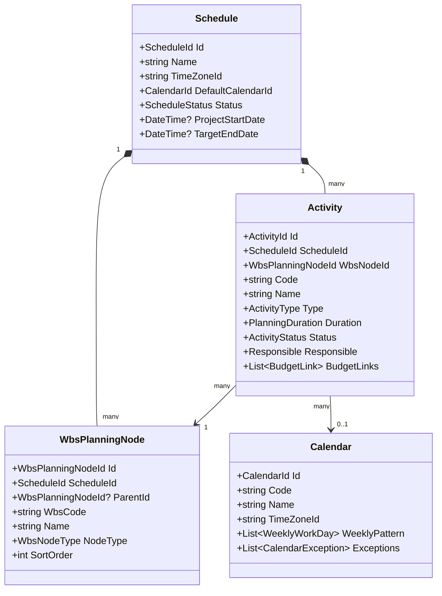

# Planning Engine Design Specification

This document details the architecture and design of the Qubi Cost Electrical project planning engine (Fase 7A).

## Core Architecture

The planning engine is designed around three main domains:
1. **Schedule**: Represents the root configuration of a project timeline.
2. **WBS (Work Breakdown Structure)**: Represents the hierarchical organization of tasks.
3. **Activities & Milestones**: Represent the leaf tasks with durations, states, and constraints.
4. **Calendars**: Represent time slots, shifts, working patterns, and exceptions.

## Security & Verification

All mutations are checked against `AuthorizationGuard` for:
- Session context (roles ESTIMATOR, ADMINISTRATOR, etc.)
- Strict read-only state checks (Approved, Archived, or Obsolete schedules)
- Transition rules of activity states.
